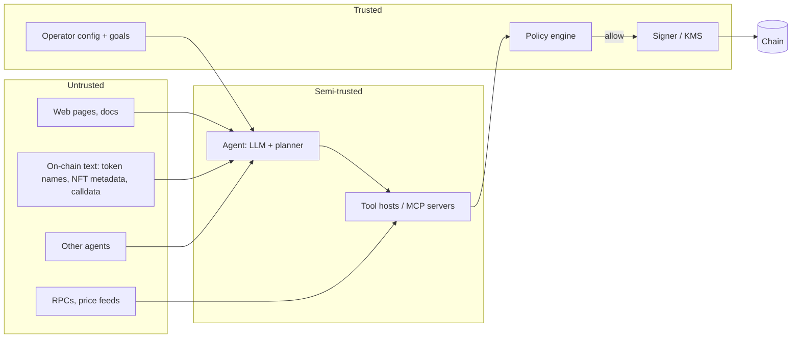

# Threat Model for Agents That Hold Keys

AI agents now trade, pay for APIs, manage treasuries and interact with DeFi protocols. When an agent can sign transactions, every weakness of LLMs, such as prompt injection, hallucination and goal drift, becomes a **direct financial risk**, and transactions are irreversible.

Traditional wallet security asks "who holds the key?". Agent wallet security adds a second question: "who can influence what the key holder decides to sign?". With an agent, the answer includes anyone who can place text in its context window. That is a much larger group than the people who can reach your servers.

## System model

```
 user / operator ──► agent (LLM + planner) ──► tools ──► signer ──► chain
                        ▲         ▲               │
                        │         │               └─ RPCs, indexers, price APIs
               untrusted content: web pages, token names, NFT metadata,
               on-chain messages, other agents, tool outputs
```

The same model with trust boundaries made explicit:



The important line is the one between the agent and the policy engine. Everything to the left of it can be influenced by an attacker. Everything to the right must not be.

## Assets
- Funds controlled by the agent's keys or smart account.
- Permissions: approvals, delegations, session keys the agent holds.
- The agent's reputation or identity (social accounts, ENS).
- Secrets in the agent's environment: API keys for exchanges, RPC providers and MPC services.

## Adversaries
1. **Content injectors:** anyone who can put text the agent will read (a token whose name carries instructions; an NFT description; a web page).
2. **Malicious tool or MCP server providers.**
3. **Compromised data sources:** RPCs returning false balances, price APIs returning manipulated prices.
4. **Other agents** in multi-agent markets that negotiate adversarially.
5. **The operator's own mistakes:** vague goals, excessive permissions.

Content injectors deserve special attention because their cost is close to zero. Deploying a token with a crafted `name()` costs a few cents on most chains, and airdropping it to thousands of addresses costs little more. Every agent that lists its balances then reads the attacker's text.

## Attack goals
- Transfer assets to the attacker.
- Grant approvals or delegations (cheaper and stealthier than a transfer).
- Make the agent trade at manipulated prices (sandwich it, or feed fake prices).
- Exfiltrate keys or secrets from the agent's environment.
- Waste funds (gas griefing, spam transactions).

| Goal | Typical vector | Control that stops it |
|---|---|---|
| Direct transfer | injected instruction | recipient allowlist at signer |
| Approval / permit | injected "please approve router" | deny approvals to non-allowlisted spenders, including EIP-712 permits |
| Bad trade | fake price API, low-liquidity pool | multi-source pricing, slippage bounds in calldata |
| Secret theft | tool with shell or file access | no secrets in agent-visible env; sandboxed tools |
| Griefing | loops, retries | rate limits and daily gas budget |

## Key principle

> The LLM is not a security boundary. Policy must be enforced **below** the model, at the signer.

Everything in this book follows from that sentence: assume the model *will* eventually be convinced to do something bad, and make sure the signer refuses. The model proposes; deterministic checks on the decoded, simulated transaction decide.

## Worked example

> **Execution status:** not executed in this book's CI; verify locally. Outputs below are expected results, not observed ones.

Threat-model a small dollar-cost-averaging (DCA) agent: once a day it buys WETH with 50 USDC on a DEX and summarises market news for its operator. Run this in a local lab with Foundry's `anvil`.

**Step 1: list inputs and mark trust.**

| Input | Source | Trusted? |
|---|---|---|
| Operator goal ("buy 50 USDC of WETH daily") | config file | yes |
| News articles | web search tool | no |
| Token balances and names | RPC + ERC-20 `name()` | no (names are attacker-controlled) |
| WETH price | single price API | no |

**Step 2: measure the current blast radius.** What could the agent sign today? Check approvals and balances it already holds:

```bash
anvil --fork-url "$MAINNET_RPC" &          # local fork, no real funds
AGENT=0xYourAgentAddress
cast balance $AGENT --rpc-url http://127.0.0.1:8545
cast call $USDC "allowance(address,address)(uint256)" $AGENT $ROUTER \
     --rpc-url http://127.0.0.1:8545
```

If the allowance prints `115792089237316195423570985008687907853269984665640564039457584007913129639935` (the maximum `uint256`), the router can move every USDC the agent ever holds. That is part of the blast radius even if the agent key is never stolen.

**Step 3: write the worst single transaction.** With a raw EOA key and no policy, it is `transfer(attacker, fullBalance)` for every token, plus `approve(attacker, max)`. Write it down with numbers. That becomes the baseline that later chapters reduce.

**Step 4: map each attack goal to a control and a test.** For every row in the goals table, write the test that proves the control works, for example: "fork test: agent receives a token whose name contains canary text `CANARY-7f3a`; assert agent nonce unchanged and no `approve` in the mempool". The test is the evidence; the model's assurance that it "would never do that" is not.

Expected deliverable: a one-page diagram like the Mermaid one above, the inputs table, the measured blast radius, and a list of tests to build in Chapters 2 and 4.

## Common pitfalls

- **Modelling only the key thief.** Most agent losses need no key theft: the legitimate signer is persuaded to sign.
- **Forgetting standing approvals.** An unlimited allowance granted months ago is still live attack surface.
- **Treating tool outputs as trusted.** A tool that fetches web content returns attacker text, even if the tool itself is benign.
- **Relying on the system prompt.** "Never send funds to unknown addresses" in a prompt is advice to the model, not a control.
- **Ignoring signatures that are not transactions.** Permit and Permit2 signatures move funds without an on-chain transaction from the agent.

## Exercises

1. Draw the system model for an agent you use or plan to build. Mark every untrusted input.
2. List the worst single transaction your agent could sign today.
3. Find three places on-chain where an attacker can place text an agent might read.

## Further reading

- OWASP Top 10 for LLM Applications and Agentic AI guidance: <https://genai.owasp.org>
- Greshake et al., "Not what you've signed up for: Compromising Real-World LLM-Integrated Applications with Indirect Prompt Injection", AISec 2023
- Simon Willison on the "lethal trifecta" (private data, untrusted content, external communication): <https://simonwillison.net>
- Foundry book (anvil, cast): <https://book.getfoundry.sh>
