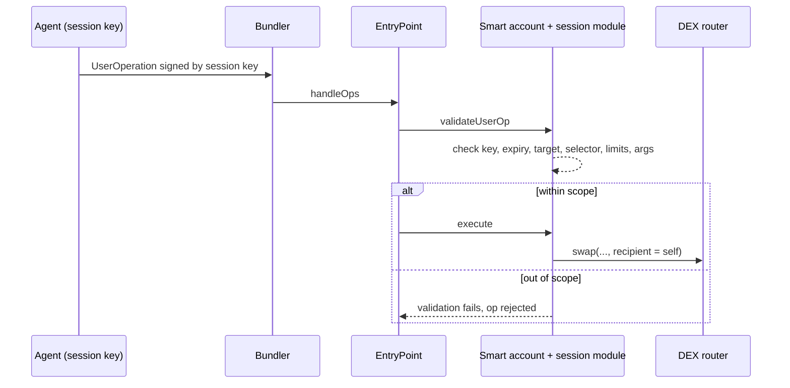

# Key Management for Agents

Giving an agent a raw private key with full control of a wallet is the most common setup and the worst one. Better options exist.

The goal of key management for agents is not to keep the agent away from keys entirely. The agent must be able to act. The goal is that **the authority the agent holds is no larger than its task**, and that the limit is enforced by something the agent cannot talk its way past: a contract, a policy engine at a custody provider, or a human co-signer.

## Options compared

| Approach | Agent holds | Limits enforceable on-chain | Notes |
|---|---|---|---|
| Raw EOA key | full key | none | key theft = total loss |
| Custodial/MPC wallet API | API credential | provider-side policies | depends on provider policy engine |
| Smart account (ERC-4337) + session key | scoped session key | yes: contract-enforced scope, expiry, limits | best general option |
| EIP-7702 delegated EOA | EOA delegated to code | yes, via delegated code | powerful; delegation target must be trusted |
| Multisig with agent as one signer | one key of M-of-N | yes: needs human co-signers | slow; good for treasuries |

A practical rule: match the option to the value at risk and the speed required. A trading agent that must act within seconds needs a session key with tight limits. A treasury agent that moves large sums weekly can afford a multisig with human co-signers.

## Session keys

A session key is a temporary key the smart account accepts **only** for a defined scope:

- allowed target contracts and function selectors,
- per-transaction and per-period value limits,
- token allowlist,
- expiry time,
- optional argument constraints (e.g. recipient must be the user's own address).

Modular smart account standards (ERC-7579 modules, and various session-key modules) implement this. The agent can be compromised entirely and still only do what the session allows.

Argument constraints are where many session-key setups are weak. Allowing "any call to the DEX router" sounds narrow, but a router's swap functions usually take a `recipient` argument. Without a constraint that the recipient is the account itself, the agent can swap the account's tokens and send the output anywhere.



## EIP-7702 caveats

EIP-7702 (live since Ethereum's Pectra upgrade) lets an EOA set code via a signed authorisation. This makes smart-account features available to existing addresses, but:

- A user tricked into signing a 7702 authorisation to a malicious contract hands over the account. Drainer kits adapted to this quickly.
- Delegation persists until changed. Agents should never sign 7702 authorisations; humans should only sign them for audited delegation contracts.
- `tx.origin == msg.sender` checks no longer reliably mean "this is an EOA without code".

## Secrets hygiene

- Keys in a KMS/HSM or the MPC provider. Never in environment variables visible to the agent's tools.
- The agent process should not have shell access on the host that holds keys.
- Rotate session keys often. Short expiries are cheap.
- Separate the **planning** process (which runs the model and reads untrusted content) from the **signing** process (which holds the session key and runs the policy). They should talk over a narrow, typed interface.
- Never log raw signing payloads together with secrets; logs are often more widely readable than the key store.

## Worked example

> **Execution status:** not executed in this book's CI; verify locally. Outputs below are expected results, not observed ones.

This lab builds a deliberately tiny session-key wallet in Foundry to show what "contract-enforced scope" means. It is a teaching model, not a production account; for real deployments use an audited ERC-4337 / ERC-7579 implementation.

```solidity
// src/SessionWallet.sol
pragma solidity ^0.8.20;
contract SessionWallet {
    address public owner;
    struct Session { address target; uint256 dailyLimit; uint64 expiry; }
    mapping(address => Session) public sessions;
    mapping(address => mapping(uint256 => uint256)) public spent; // key => day => wei

    constructor() payable { owner = msg.sender; }

    function grant(address key, address target, uint256 limit, uint64 expiry) external {
        require(msg.sender == owner, "owner");
        sessions[key] = Session(target, limit, expiry);
    }
    function revoke(address key) external {
        require(msg.sender == owner, "owner");
        delete sessions[key];
    }
    function execute(address to, uint256 value, bytes calldata data) external {
        if (msg.sender != owner) {
            Session memory s = sessions[msg.sender];
            require(block.timestamp < s.expiry, "expired");
            require(to == s.target, "target");
            uint256 day = block.timestamp / 1 days;
            spent[msg.sender][day] += value;
            require(spent[msg.sender][day] <= s.dailyLimit, "limit");
        }
        (bool ok,) = to.call{value: value}(data);
        require(ok, "call");
    }
}
```

```solidity
// test/SessionWallet.t.sol
pragma solidity ^0.8.20;
import "forge-std/Test.sol";
import "../src/SessionWallet.sol";

contract SessionWalletTest is Test {
    SessionWallet w; address agent = makeAddr("agent");
    address router = makeAddr("router"); address thief = makeAddr("thief");

    function setUp() public {
        w = new SessionWallet{value: 10 ether}();
        w.grant(agent, router, 0.1 ether, uint64(block.timestamp + 1 days));
    }
    function test_withinScope() public {
        vm.prank(agent); w.execute(router, 0.05 ether, "");
    }
    function test_wrongTarget() public {
        vm.prank(agent); vm.expectRevert(bytes("target"));
        w.execute(thief, 0.01 ether, "");
    }
    function test_overLimit() public {
        vm.startPrank(agent);
        w.execute(router, 0.08 ether, "");
        vm.expectRevert(bytes("limit"));
        w.execute(router, 0.05 ether, "");
    }
    function test_expired() public {
        vm.warp(block.timestamp + 2 days);
        vm.prank(agent); vm.expectRevert(bytes("expired"));
        w.execute(router, 0.01 ether, "");
    }
    function test_revoked() public {
        w.revoke(agent);
        vm.prank(agent); vm.expectRevert(bytes("expired"));
        w.execute(router, 0.01 ether, "");
    }
}
```

Run `forge test -vv`. Expected: five passing tests. Each test is a statement about what a fully compromised agent **cannot** do, checked by the EVM rather than by reading the agent's prompt.

Then extend it: add a selector allowlist (`bytes4(data[:4])`) and notice that the current design still lets the agent call any function on the router. That gap is exactly the argument-constraint problem described above.

## Common pitfalls

- **Scoping by target only.** Constrain selectors and critical arguments such as `recipient`.
- **Long-lived sessions.** A 90-day session key is a hot wallet with extra steps. Prefer hours or days and automate renewal.
- **Unlimited token approvals from the smart account.** The session limit on ETH value does nothing if the router already has a max allowance on USDC.
- **Keys in the agent's environment.** Any tool with file or shell access can then read them.
- **Letting agents sign EIP-7702 authorisations or arbitrary EIP-712 data.** Both can transfer control without a normal transaction.

## Exercises

1. Deploy an ERC-4337 smart account on a testnet with a session key limited to one DEX router and 0.1 ETH/day. Try to exceed it.
2. Write a short explainer on why `tx.origin` checks changed meaning after EIP-7702.
3. Compare two MPC wallet providers' policy engines: what can they enforce?

## Further reading

- ERC-4337: <https://eips.ethereum.org/EIPS/eip-4337>
- ERC-7579 (modular smart accounts): <https://eips.ethereum.org/EIPS/eip-7579>
- EIP-7702: <https://eips.ethereum.org/EIPS/eip-7702>
- Safe smart account docs: <https://docs.safe.global>
- Foundry testing cheatcodes: <https://book.getfoundry.sh/cheatcodes/>
