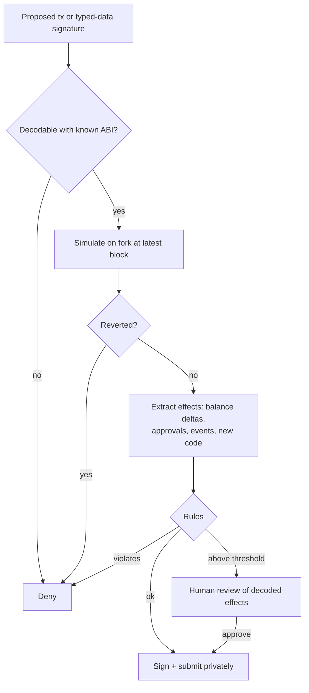

# Policy Engines and Transaction Simulation

The signer-side policy engine is the real security boundary. It decides whether a transaction the agent proposes gets signed.

A policy engine is deliberately boring software. It does not reason, summarise or guess. It decodes, simulates, compares numbers against limits and returns allow, deny or escalate. That boringness is the point: its behaviour is the same no matter what text the agent read, so an attacker who controls the agent's context gains nothing by targeting it.

## Policy layers

```
agent proposes tx
  → decode (ABI, known selectors; unknown = deny by default)
  → simulate on fork (balance changes, approvals, events, reverts)
  → evaluate policy rules on the *simulated effects*
  → allow | deny | escalate to human
  → sign + submit (preferably via private orderflow to avoid sandwiching)
```

Rules should evaluate **effects**, not intentions. The agent might call an allowlisted router with a path that swaps everything into an attacker token, so check the resulting balance changes.



## Example policy (declarative)

```yaml
default: deny
rules:
  - name: dex-swaps
    allow_targets: [UNISWAP_UNIVERSAL_ROUTER]
    max_value_usd_per_tx: 500
    max_value_usd_per_day: 2000
    require:
      - simulated_output_tokens subset_of [USDC, WETH, DAI]
      - simulated_slippage_bps <= 100
      - recipient == self
  - name: no-approvals-to-unknown
    deny_if: approval.spender not in ALLOWLIST
  - name: no-7702
    deny_if: tx.type == 4
escalate:
  - value_usd > 500
  - new_counterparty
```

Each rule should be expressible as a pure function from (decoded call, simulated effects, history) to a decision. If a rule needs a model to evaluate it, it is not a policy rule; it is a hint.

## What "effects" means in practice

| Effect | How to extract it | Typical rule |
|---|---|---|
| Native balance change | balance before/after simulation | daily outflow cap |
| ERC-20 balance change | `Transfer` events or `balanceOf` diff for tracked tokens | output tokens in allowlist; net loss bounded |
| New approvals | `Approval` events, Permit2 state | spender in allowlist; amount bounded |
| Code changes | `eth_getCode` before/after (EIP-7702 delegation) | always deny for agents |
| Contract creation | trace | deny unless explicitly expected |

## Simulation pitfalls

- **State changes between simulation and inclusion.** Use slippage limits and short deadlines in the transaction itself.
- **Simulation-aware contracts** that behave differently when they detect a simulation (e.g. checking `block.coinbase`, gas price or timestamps). Prefer simulators that mirror real block context, and treat unverified contracts as high risk regardless of simulation.
- **Price data integrity:** compute USD values from several sources. An attacker who controls the price API controls the limits.
- **Incomplete token tracking.** If you only diff balances of tokens you already know, an attacker token that the swap outputs goes unnoticed. Derive the token list from `Transfer` events in the simulation, not from a static list.

## Off-the-shelf components

Transaction simulation APIs (Tenderly, Alchemy, Blowfish-style wallet security APIs), open-source fork simulation with Anvil or revm, and policy features in MPC/custody providers. Check how each handles unknown contracts and typed-data signatures. Signatures (permits) need the same policy treatment as transactions.

## Typed-data signatures

Not every dangerous action is a transaction. EIP-712 typed-data signatures power gasless approvals (EIP-2612 `permit`, Uniswap's Permit2), off-chain order books and many login flows. A signed permit lets anyone holding it set an allowance on the agent's tokens, and the agent never sends a transaction that a transaction-only policy would see.

Treat signing requests as a second input type to the same engine. Decode the domain (chain ID, verifying contract) and the primary type. Deny unknown primary types by default. For known approval types, apply the spender allowlist and amount caps you apply to `approve`. For order types, compute the worst-case fill as if it executed immediately and apply the value limits. Deadlines matter too: a permit with an expiry years in the future is a standing liability.

## Worked example

> **Execution status:** not executed in this book's CI; verify locally. Outputs below are expected results, not observed ones.

A minimal simulate-then-decide engine in Python with `web3.py` and a local `anvil` fork. It uses Anvil's real RPC methods `evm_snapshot`, `evm_revert` and `anvil_impersonateAccount` to run the proposed transaction and roll it back.

```python
# policy.py  (pip install web3)
from web3 import Web3
w3 = Web3(Web3.HTTPProvider("http://127.0.0.1:8545"))
TRANSFER = w3.keccak(text="Transfer(address,address,uint256)").hex()
APPROVAL = w3.keccak(text="Approval(address,address,uint256)").hex()
ALLOWED_TARGETS = {Web3.to_checksum_address("0x" + "11" * 20)}  # your router
ALLOWED_SPENDERS = set(ALLOWED_TARGETS)
MAX_ETH_OUT = w3.to_wei(0.1, "ether")

def norm(h): return h if h.startswith("0x") else "0x" + h

def simulate(tx):
    snap = w3.provider.make_request("evm_snapshot", [])["result"]
    w3.provider.make_request("anvil_impersonateAccount", [tx["from"]])
    before = w3.eth.get_balance(tx["from"])
    try:
        h = w3.eth.send_transaction(tx)
        rcpt = w3.eth.wait_for_transaction_receipt(h)
        after = w3.eth.get_balance(tx["from"])
        gas = rcpt.gasUsed * rcpt.effectiveGasPrice
        return rcpt, before - after - gas
    finally:
        w3.provider.make_request("evm_revert", [snap])

def decide(tx):
    if Web3.to_checksum_address(tx["to"]) not in ALLOWED_TARGETS:
        return "deny: target"
    rcpt, eth_out = simulate(tx)
    if rcpt.status != 1:
        return "deny: reverted"
    if eth_out > MAX_ETH_OUT:
        return f"deny: eth_out {eth_out}"
    owner_topic = "0x" + tx["from"][2:].lower().rjust(64, "0")
    for log in rcpt.logs:
        t0 = norm(log["topics"][0].hex())
        if t0 == norm(APPROVAL) and norm(log["topics"][1].hex()) == owner_topic:
            spender = Web3.to_checksum_address("0x" + log["topics"][2].hex()[-40:])
            if spender not in ALLOWED_SPENDERS:
                return f"deny: approval to {spender}"
    return "allow"
```

Test it against three proposals built by hand (the "agent" here is you, playing a compromised agent):

```python
agent = w3.eth.accounts[1]
router = list(ALLOWED_TARGETS)[0]
print(decide({"from": agent, "to": router, "value": w3.to_wei(0.05, "ether")}))
print(decide({"from": agent, "to": router, "value": w3.to_wei(1, "ether")}))
print(decide({"from": agent, "to": w3.eth.accounts[2], "value": 1}))
```

Expected output:

```
allow
deny: eth_out 1000000000000000000
deny: target
```

Then add an ERC-20 `approve` to a non-allowlisted spender (deploy any test token, or use a forked USDC) and confirm the `Approval` rule fires. Because the engine reads events from a real EVM execution, the decision does not depend on what the agent claimed the transaction would do.

## Common pitfalls

- **Default allow.** Unknown selectors and unknown contracts must be denied or escalated.
- **Evaluating the agent's description instead of the calldata.** Decode and simulate every time.
- **Ignoring off-chain signatures.** Permit, Permit2 and order-book signatures move funds; route them through the same engine.
- **Simulating against stale state.** Fork from the latest block, and keep deadlines short in the transaction.
- **Human review screens that show agent prose.** Show decoded calls and simulated balance changes only.
- **Policy code reachable from the agent's tools.** If the agent can edit the YAML, the policy is advisory.

## Exercises

1. Implement the YAML policy above with revm or Anvil simulation in Python or Rust.
2. Write a contract that behaves differently under simulation. Does your simulator catch it?
3. Add EIP-712 typed-data policies: deny any Permit/Permit2 whose spender is not allowlisted.

## Further reading

- revm: <https://github.com/bluealloy/revm>
- Anvil: <https://book.getfoundry.sh/anvil/>
- Tenderly simulation docs: <https://docs.tenderly.co>
- Flashbots Protect (private orderflow): <https://docs.flashbots.net>
- web3.py documentation: <https://web3py.readthedocs.io>
