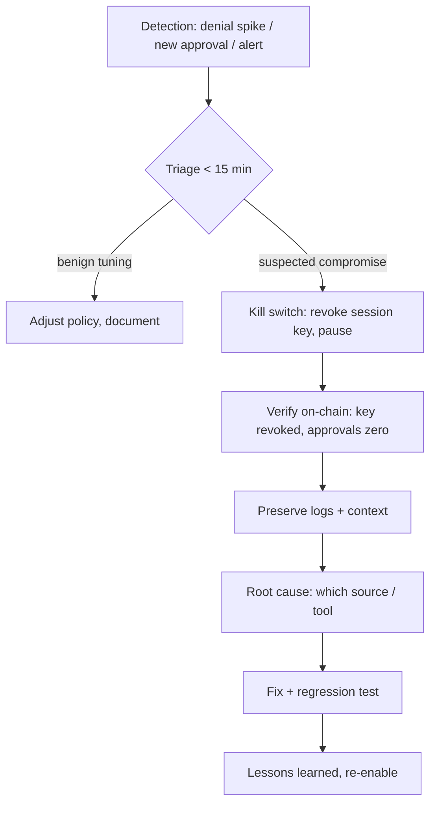

# Monitoring and Incident Response for Agent Wallets

Even with good policies, plan for the day something goes wrong. Policies have gaps, simulators miss edge cases, and operators grant broader permissions under deadline pressure. Monitoring shortens the time between the first bad decision and your response, and a rehearsed runbook shortens the time from detection to containment.

## What to log

- Every model input that led to a transaction proposal (with untrusted spans marked).
- The proposal, decoded call, simulation result and policy decision (allow/deny/escalate with rule name).
- Signed transaction hashes and final on-chain outcome.
- Tool definition hashes and model version per session.

Store logs outside the agent's reach, append-only, so a compromised agent cannot erase its tracks.

A single structured record per decision makes everything later easier. One JSON line per proposal is enough:

```json
{"ts":"2026-10-22T09:14:03Z","session":"s-42","model":"model-x-2026-09",
 "tools_pin":"3f1c...","proposal":{"to":"0x11..","selector":"0x3593564c","value":"0"},
 "sim":{"status":1,"eth_out":"0","approvals":[]},"decision":"deny","rule":"target",
 "untrusted_sources":["erc20:name:0xCNRY.."]}
```

## Detection signals

- Spike in **policy denials**, often the first sign of a successful injection attempt that the signer blocked.
- New counterparties or contracts.
- Approvals or delegations of any kind.
- Divergence between the agent's stated intent and the simulated effect.
- Unusual timing (activity outside the operator's normal hours) or frequency.

Denials are the most valuable signal and the most often ignored. A denial means the agent tried to do something outside policy. Either the policy is too tight (a tuning issue) or the agent was steered (a security issue). Both deserve a look, and a sudden cluster of denials after the agent read a particular source is a strong injection indicator.

## Kill switches

- **Revoke session keys** on the smart account (one transaction, can be pre-signed or done by a guardian).
- **Pause module** that blocks all agent-originated operations.
- **Revoke approvals** using a prepared script with the list of tokens and spenders.
- Rotate API credentials for tools and MPC providers.

Practise these. A kill switch nobody has used will fail during an incident.



## Incident runbook (short form)

1. Trigger kill switch; confirm on-chain that the session key is revoked.
2. Preserve logs and the agent's context at the time.
3. Identify the injection source (which content or tool) and remove it.
4. Assess on-chain impact; trace funds if lost (see the **onchain-malware-analysis** book, Chapter 7); contact SEAL 911 if large.
5. Fix: policy rule, tool design, or quarantine boundary. Add the payload to the regression suite.

Step 1 includes the word "confirm". Sending a revocation transaction is not the same as having revoked. Read the state back.

## Worked example

> **Execution status:** not executed in this book's CI; verify locally. Outputs below are expected results, not observed ones.

Two pieces: a denial-spike detector over the JSONL log, and a rehearsed revocation on a local chain.

**Part 1: denial-spike alerting.**

```python
# denials.py  usage: python denials.py decisions.jsonl
import json, sys
from collections import Counter
from datetime import datetime

WINDOW_MIN, THRESHOLD = 10, 5
buckets = Counter(); sources = Counter()
for line in open(sys.argv[1]):
    r = json.loads(line)
    if r["decision"] != "deny":
        continue
    t = datetime.fromisoformat(r["ts"].replace("Z", "+00:00"))
    key = t.replace(minute=t.minute - t.minute % WINDOW_MIN, second=0, microsecond=0)
    buckets[key] += 1
    for s in r.get("untrusted_sources", []):
        sources[s] += 1
for k, n in sorted(buckets.items()):
    if n >= THRESHOLD:
        print(f"ALERT {k.isoformat()} denials={n}")
print("top untrusted sources near denials:", sources.most_common(3))
```

Generate test data by replaying the Chapter 2 canary scenario a few times with the policy engine active. Expected: one `ALERT` line for the window in which the agent read the canary token, and that token listed as the top source. The alert is driven by policy decisions, which are deterministic records, not by asking a model whether something "looks suspicious".

**Part 2: rehearse the kill switch** with the `SessionWallet` from Chapter 3 deployed on `anvil`.

```bash
# revoke the agent's session key
cast send $WALLET "revoke(address)" $AGENT --private-key $OWNER_KEY \
     --rpc-url http://127.0.0.1:8545
# confirm: expiry should now read 0
cast call $WALLET "sessions(address)(address,uint256,uint64)" $AGENT \
     --rpc-url http://127.0.0.1:8545
# revoke a token approval the account granted earlier
cast send $TOKEN "approve(address,uint256)" $SPENDER 0 --private-key $OWNER_KEY \
     --rpc-url http://127.0.0.1:8545
cast call $TOKEN "allowance(address,address)(uint256)" $OWNER $SPENDER \
     --rpc-url http://127.0.0.1:8545     # expect 0
```

Time the whole drill. Write the commands, addresses and expected outputs into the runbook so that the person on call at 3 a.m. does not have to work them out.

## Common pitfalls

- **Logs stored where the agent can write.** A compromised tool can delete evidence.
- **Alerting only on successful transactions.** Denials and escalations arrive earlier.
- **Kill switch that depends on the agent's infrastructure.** If the revocation key lives on the compromised host, it is not a kill switch.
- **Forgetting approvals and off-chain signatures.** Revoking the session key does not cancel a permit already signed.
- **No regression test after the fix.** The same payload often returns in a new channel.
- **Going public before coordinating.** If a third-party tool or protocol is involved, coordinate disclosure with its maintainers.

## Exercises

1. Implement denial-spike alerting over the policy engine's log.
2. Pre-sign and test a session-key revocation on a testnet.
3. Run a tabletop exercise: an NFT metadata injection caused an approval. Walk through the runbook with your team.

## Further reading

- SEAL 911: <https://securityalliance.org>
- NIST SP 800-61 Rev. 3 (incident response): <https://csrc.nist.gov/pubs/sp/800/61/r3/final>
- Safe guards and modules: <https://docs.safe.global>
- Revoke.cash (approval review and revocation): <https://revoke.cash>
